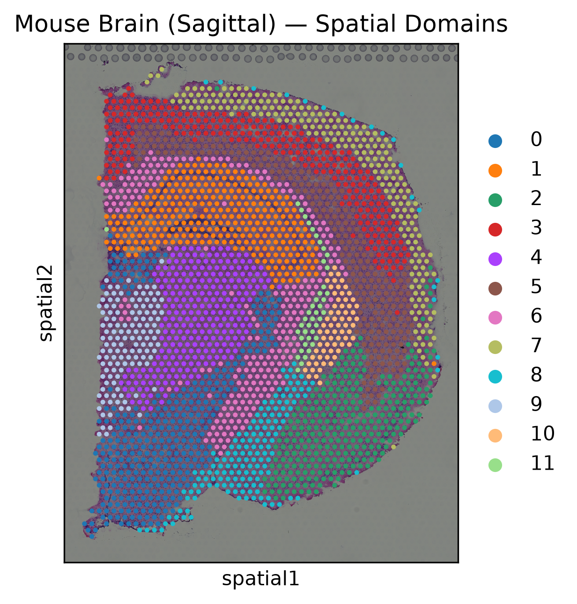

# Spatially-Constrained-CCC

> Does physical distance matter when two cells "talk" to each other? This project builds a computational pipeline to find out — quantitatively — using real spatial transcriptomics data from a mouse brain tissue section.


---

## 📖 Table of Contents

1. [What Is Spatial Omics? (A Primer)](#-what-is-spatial-omics-a-primer)
2. [The Problem This Project Tackles](#-the-problem-this-project-tackles)
3. [What This Project Actually Does](#-what-this-project-actually-does)
4. [Results](#-results)
5. [Methodology, Phase by Phase](#-methodology-phase-by-phase)
6. [Tech Stack](#-tech-stack)
7. [Why This Matters at Scale](#-why-this-matters-at-scale)
8. [Repository Structure](#-repository-structure)
9. [Installation & Setup](#-installation--setup)
10. [Usage](#-usage)
11. [Limitations & Honest Caveats](#-limitations--honest-caveats)
12. [What's Next](#-whats-next)

---

## 🧬 What Is Spatial Omics? (A Primer)

For decades, the standard way to study gene expression in a tissue was **single-cell RNA sequencing (scRNA-seq)**. The process, roughly: take a piece of tissue, dissolve it into a soup of individual cells, and sequence the RNA in each one. This tells you *which* cell types are present and *what* genes they're expressing — but it destroys something crucial in the process: **where each cell was originally sitting relative to its neighbors.**

Imagine trying to understand a city by dissolving all its buildings into a pile of bricks, then trying to reconstruct the street layout from the pile. You'd know what materials the city was made of, but you'd have no idea which building was next to which, where the roads were, or how neighborhoods were organized. That's what dissociation-based scRNA-seq does to tissue architecture.

**Spatial Transcriptomics (ST)** fixes this. Platforms like **10x Genomics Visium** place a tissue slice directly onto a slide printed with thousands of tiny spots, each with a known (x, y) coordinate and its own set of barcoded probes. RNA from the tissue sitting on top of each spot gets captured and sequenced *in place*. The result: a genome-wide expression profile **for every physical location on the tissue**, paired with the original histology image (H&E stain) underneath it. You get the "what" (gene expression) and the "where" (spatial coordinates) simultaneously.

This matters enormously for **cell-cell communication (CCC)** — the study of how cells signal to each other via ligand-receptor pairs (a protein on one cell binding a receptor on another). Most cell-surface signaling requires the two cells to be physically close, often touching or within a few cell-diameters. If you only know *what* cell types exist in a tissue but not *where* they are, you can't actually tell whether a predicted signaling interaction is biologically plausible or not.

---

## 🎯 The Problem This Project Tackles

Traditional computational CCC-inference tools (the classic approach) work like this: take an expression matrix, group cells into types, and check whether ligand genes in one group correlate with receptor genes in another. This is often called the **"soup" model** — it implicitly assumes every cell type can freely interact with every other cell type, as if the whole tissue were homogeneously mixed.

But real tissue isn't a soup. It's organized into layers, regions, and domains. A signaling interaction that looks statistically strong in a "soup" analysis might be biologically meaningless if the two cell types in question are never actually adjacent in the real tissue.

**This project asks a simple, falsifiable question**: *if we take a set of computationally-predicted ligand-receptor interactions and cross-check them against real spatial adjacency, how many of them survive?* Put differently: **how big is the false-positive problem in non-spatial cell-cell communication analysis, and can we fix it?**

---

## 🔬 What This Project Actually Does

This is a from-scratch Python pipeline that:

1. Downloads and quality-controls a real 10x Genomics Visium spatial transcriptomics dataset (mouse brain, sagittal section).
2. Clusters the tissue into distinct spatial domains based on gene expression (unsupervised, via Leiden clustering).
3. Builds a **physical adjacency graph** of the tissue — literally, which spots are next to which other spots on the slide.
4. Runs a **standard, non-spatial** ligand-receptor communication analysis (the "soup" model) to get a baseline set of predicted interactions.
5. Cross-references every predicted interaction against the physical adjacency graph, using a proper statistical significance threshold (not just "any positive signal").
6. Reports exactly how many of the originally-predicted interactions survive the spatial reality check — and visualizes what's left.

This is a small-scale, single-slide **proof of concept**, deliberately scoped to run end-to-end on a standard laptop, not a cluster. It's meant as an introductory exploration into spatial omics, not a publication-grade study — see [Limitations](#-limitations--honest-caveats) below for an honest breakdown of what it does and doesn't establish.

---

## 📊 Results

Running the full pipeline on the mouse brain Visium dataset:

| Metric | Value |
|---|---|
| Ligand-receptor interactions predicted (non-spatial, "soup" model) | **7,659** |
| Interactions surviving spatial-adjacency significance filter (z > 1.96, p < 0.05) | **876** |
| Interactions eliminated as spatially implausible | **6,783** |
| **False-positive rate of the non-spatial approach** | **88.56%** |

In plain terms: of every 100 cell-cell communication events predicted by the standard non-spatial method, roughly **89 of them** involve cell populations that aren't even physically near each other on the real tissue. Only about 11% hold up once you check whether the signaling cells are actually close enough to plausibly interact.

The interactions that *do* survive are concentrated around genes like `App`, `Aplp1/2`, `Psap`, `Apoe`, and their receptors (`Sort1`, `Lrp1`, `Gpr37`) — a signaling network associated with lipid transport and neuronal maintenance, which is expected and biologically sensible for brain tissue, and a good sanity check that the pipeline isn't just filtering randomly.

### Visuals

**1. Spatial domain clustering** — unsupervised Leiden clusters overlaid on the original H&E tissue image, showing the tissue naturally separating into anatomically distinct regions (visible cortical layering and hippocampal structure):



**2. Spatially-validated interactions** — dot plot of the top ligand-receptor pairs that survived the physical-adjacency significance filter, faceted by source cluster:


**3. Interactive spatial map** — the same clustering, as a zoomable/hoverable Plotly export. GitHub can't render interactive HTML inline, so view it directly: **[Open interactive_clusters.html](assets/interactive_clusters.html)** (click "Download" or "raw" on that page, then open the downloaded file in your browser — GitHub shows HTML as raw text, not live, but the file itself is fully interactive locally).

> Tip: if you want it viewable live in-browser without downloading, you can host it via [GitHub Pages](https://pages.github.com/) (enable Pages on this repo, pointed at the `assets/` folder) or link through [htmlpreview.github.io](https://htmlpreview.github.io/) using your raw file URL.

---

## 🛠 Methodology, Phase by Phase

| Phase | Script | What Happens |
|---|---|---|
| **1. Data Prep & QC** | `01_data_prep.py` | Downloads the 10x Genomics Visium Mouse Brain (Sagittal) dataset via Squidpy's data loader (real experimental data, hosted by the scverse project for reproducible tutorials — not synthetic). Filters low-quality spots (`min_counts=500`) and rarely-detected genes (`min_cells=10`). Normalizes total counts and log-transforms expression. |
| **2. Clustering & Spatial Graph** | `02_spatial_clustering.py` | Runs PCA → neighbor graph → Leiden clustering (resolution 0.5) to define spatial/transcriptomic domains. Separately, builds a **physical** spatial neighbor graph directly from the tissue's (x, y) coordinates via `sq.gr.spatial_neighbors`. Exports an interactive Plotly visualization of the domains. |
| **3. Cell-Cell Communication** | `03_ccc_analysis.py` | **Run 1 (non-spatial):** `liana`'s rank-aggregate method scores every ligand-receptor pair across every cluster combination, ignoring physical location entirely — the "soup" model. **Run 2 (spatial constraint):** `sq.gr.nhood_enrichment` computes a permutation-tested z-score for how much more (or less) than chance two clusters are physically adjacent. Every interaction from Run 1 is checked: is the source and target cluster pair adjacent at z > 1.96 (p < 0.05)? Interactions that fail are discarded as spatially implausible. |
| **4. Visualization** | `04_regenerate_tissue_plot.py` | Renders cluster identities back onto the original tissue image for a human-readable sanity check — do the computational domains actually correspond to real anatomical structure? |

**Why z > 1.96 specifically?** Squidpy's neighborhood enrichment test works by repeatedly shuffling cluster labels across the tissue and rebuilding a null distribution of "how often would these two clusters be this adjacent purely by chance." The z-score tells you how many standard deviations the *real* adjacency is from that null. Under the standard normal approximation, z > 1.96 is the conventional two-tailed 95% confidence threshold (p < 0.05) — the same convention used in the neighborhood-enrichment literature this method is built on. A weaker "just check if it's positive" threshold would let statistically noisy, non-significant adjacency pairs count as validated, inflating the apparent CCC signal.

---

## 🧰 Tech Stack

| Purpose | Library |
|---|---|
| Single-cell / spatial data structures | [AnnData](https://anndata.readthedocs.io/), [Scanpy](https://scanpy.readthedocs.io/) |
| Spatial neighborhood graphs & enrichment | [Squidpy](https://squidpy.readthedocs.io/) |
| Ligand-receptor communication inference | [LIANA+](https://liana-py.readthedocs.io/) |
| Interactive visualization | [Plotly](https://plotly.com/python/) |
| Core numerics | NumPy, pandas |

All versions are pinned in `requirements.txt` — see [Installation](#-installation--setup).

---

## 🔭 Why This Matters at Scale

This project runs on a single Visium slide (~2,700 spots, one tissue section) on a laptop, in a few minutes. That's intentionally small — it's a learning exercise. But the exact same logic scales up to real, high-stakes biomedical research:

- **Cancer immunotherapy.** Whether a T-cell can actually attack a tumor cell depends on whether the T-cell is physically present at the tumor boundary, not just whether the right receptors are expressed *somewhere* in the tumor sample. Spatially-validated CCC is now a standard analytical layer in tumor microenvironment studies (breast, lung, and colorectal cancer spatial atlases all use adjacency-constrained interaction analysis for exactly this reason).
- **Neurodegeneration.** The `App`/`Apoe`/`Psap` signaling axis that showed up in this project's own results is directly implicated in Alzheimer's disease research — spatial context (which brain regions show this signaling, and where amyloid plaques physically form relative to it) is central to current research into disease progression.
- **Drug target validation.** Pharma pipelines increasingly use spatial CCC analysis to ask "if we block this ligand-receptor pair, does it actually happen where the disease is active?" before committing to expensive downstream validation.
- **Larger-scale technology.** Newer platforms (10x Xenium, MERFISH, Slide-seq) push this same idea to **single-cell and sub-cellular resolution** across whole organs, and multi-sample cohort studies apply this same bulk-vs-spatial comparison across dozens to hundreds of patients to find spatial signatures that generalize. The computational logic in this repo — build an adjacency graph, cross-reference predicted interactions against it, quantify what survives — is the same logic, just at much larger scale and often distributed across HPC clusters instead of a single laptop.

In short: this project is a small, honest, reproducible version of a real methodological question that spatial biology labs and pharma companies are actively working on today.

---

## 📁 Repository Structure

```
Spatially-Constrained-CCC/
├── scripts/
│   ├── 01_data_prep.py              # Download + QC + normalize
│   ├── 02_spatial_clustering.py     # Cluster + spatial graph + interactive plot
│   ├── 03_ccc_analysis.py           # Non-spatial vs. spatially-constrained CCC
│   └── 04_regenerate_tissue_plot.py # Cluster-on-tissue visualization
├── data/                            # Generated .h5ad files (gitignored — regenerate via scripts)
├── outputs/                         # Generated plots (copy into assets/ for README rendering)
├── assets/                          # Final visuals referenced by this README
├── requirements.txt                 # Pinned dependency versions
├── .python-version                  # Required Python version (3.12)
└── README.md
```

---

## ⚙️ Installation & Setup

**Requires Python 3.10–3.13** (LIANA+ does not yet support 3.14+).

```bash
git clone https://github.com/Eswar-mse/Spatially-Constrained-CCC.git
cd Spatially-Constrained-CCC

python3.12 -m venv spatial_env
source spatial_env/bin/activate

pip install -r requirements.txt
```

---

## ▶️ Usage

Run the pipeline in order from the project root:

```bash
python scripts/01_data_prep.py
python scripts/02_spatial_clustering.py
python scripts/03_ccc_analysis.py
python scripts/04_regenerate_tissue_plot.py
```

Each script is self-contained and anchors its file paths to the project root automatically — you can run them from anywhere inside the repo.

Outputs land in `outputs/`: an interactive HTML cluster map, a spatially-validated interaction dot plot (PNG + PDF), and a tissue-overlay cluster image.

---

## ⚠️ Limitations & Honest Caveats

This is an exploratory, single-sample project — worth being upfront about what it does *not* show:

- **Single tissue slice, single biological replicate.** No claim of generalizability across animals, conditions, or disease states — that would require a proper cohort.
- **Cluster identities are unannotated.** Clusters are numbered (0–11), not biologically labeled (e.g., "cortical layer IV", "hippocampus") — that would need marker-gene-based annotation against a reference atlas.
- **Correlational, not mechanistic.** Spatial adjacency plus co-expression is still an *inference*, not direct evidence of an active signaling event — it narrows the plausible candidate set, it doesn't prove interaction.
- **z > 1.96 is a standard but simplifying threshold.** It doesn't correct for multiple comparisons across all cluster pairs tested; a stricter analysis would apply an FDR correction.

---

## 🚀 What's Next

- Apply this same pipeline to a real human breast cancer Visium dataset (tumor-immune boundary), the original motivating use case for this project.
- Annotate clusters against known marker genes instead of leaving them numeric.
- Add FDR-corrected significance testing for the adjacency filter.
- Extend to multi-sample comparison once more than one tissue slice is available.

---

*This is an independent exploratory project for learning spatial transcriptomics analysis end-to-end — from raw data to a defensible, statistically-grounded biological claim.*
