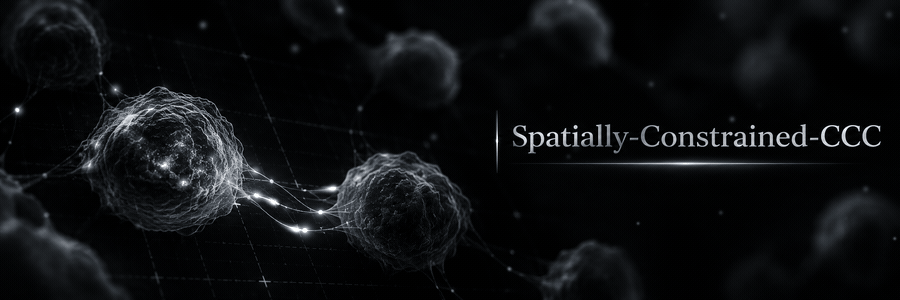
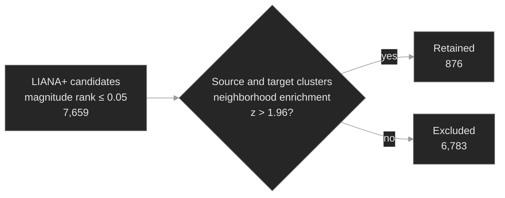
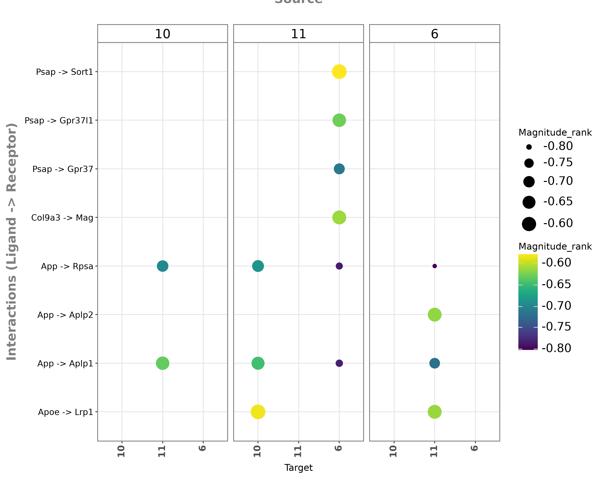
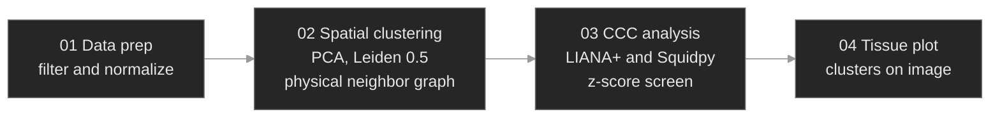

<div align="center">
  
</div>

<div align="center">
<a href="https://eswar-mse.github.io/Spatially-Constrained-CCC/"></a>
<a href="https://eswar-mse.github.io/Spatially-Constrained-CCC/assets/interactive_clusters.html"></a>

<br/>


</div>


<div align="center">
<h3>Exploratory Ligand–Receptor Screening in a 10x Visium Mouse Brain Section</h3>
</div>

<p align="justify">

An exploratory analysis of ligand–receptor candidates in a <b>10x Visium mouse brain sagittal section</b>. The pipeline compares expression-based candidates with the spatial neighborhood enrichment of their source and target clusters.
</p>

<p align="center"><sub>GitHub's file viewer displays HTML source rather than running the plot. Use the hosted buttons above to interact with it.</sub></p>

<div align="center">

<br>
<sub><b>Mouse brain tissue with Leiden clusters.</b></sub>
</div>


<div align="center">
<h3>Question and Result</h3>
</div>

<p align="justify">

Can tissue position help prioritize cell communication candidates inferred from expression alone? In the original exploratory run, LIANA+ produced <b>7,659</b> candidates below a magnitude rank cutoff of 0.05. <b>876</b> were retained after requiring source and target clusters to have Squidpy neighborhood enrichment <b>z &gt; 1.96</b>; <b>6,783</b> were excluded. The retention rate was <b>11.44%</b>.
</p>

<div align="center">
<table>
  <tr>
    <td align="center"><h2>7,659</h2>LIANA+ candidates</td>
    <td align="center"><h2>876</h2>retained</td>
    <td align="center"><h2>6,783</h2>excluded</td>
    <td align="center"><h2>11.44%</h2>retention rate</td>
    <td align="center"><h2>z &gt; 1.96</h2>enrichment threshold</td>
  </tr>
</table>
</div>



> **Read this carefully.** These figures are from the original run and have not been independently reproduced as part of the portfolio update. An excluded candidate is **not a proven false positive**. Neighborhood enrichment is a cluster pair statistic, not evidence for or against an individual ligand–receptor event. In particular, this screen can exclude biologically real longer range signaling.

<div align="center">

<br>
<sub><b>Top retained ligand–receptor candidates.</b></sub>
</div>


<div align="center">
<h3>Pipeline</h3>
</div>



| Step | Script | What it does |
|---|---|---|
| 1 | `scripts/01_data_prep.py` | Downloads Squidpy's `visium_hne_adata` mouse brain example, filters spots with fewer than 500 counts and genes seen in fewer than 10 spots, then normalizes and log transforms expression. |
| 2 | `scripts/02_spatial_clustering.py` | Runs PCA, a transcriptomic neighbor graph and Leiden clustering at resolution 0.5. Separately builds a **physical** spatial neighbor graph and exports an interactive tissue map. |
| 3 | `scripts/03_ccc_analysis.py` | Uses LIANA+ rank aggregation with the `mouseconsensus` resource, selects candidates with `magnitude_rank <= 0.05`, computes neighborhood enrichment with 1,000 permutations and seed 42, and applies the cluster pair z score screen. Writes full and retained candidate tables, an adjacency matrix, a JSON summary, and a dot plot. |
| 4 | `scripts/04_regenerate_tissue_plot.py` | Renders clusters on the tissue image. |

<p align="justify">

The interactive case study source is in <a href="docs/"><code>docs/</code></a> and is published through GitHub Pages. Its assets are independent of the compute pipeline.
</p>


<div align="center">
<h3>Run Locally</h3>
</div>

<p align="justify">

Use <b>Python 3.12</b>. The pinned analysis packages are in <a href="requirements.txt"><code>requirements.txt</code></a>.
</p>

```bash
python3.12 -m venv .venv
source .venv/bin/activate
python -m pip install -r requirements.txt
python scripts/01_data_prep.py
python scripts/02_spatial_clustering.py
python scripts/03_ccc_analysis.py
python scripts/04_regenerate_tissue_plot.py
```

<p align="justify">

The first step downloads a large <code>.h5ad</code> dataset. Generated data remains in <code>data/</code>; analysis exports are written to <code>outputs/</code>. The repo includes selected example figures in <code>assets/</code>. If you rerun with a different library version, dataset revision, or clustering outcome, expect the counts to change.
</p>


<div align="center">
<h3>Interpretation Limits</h3>
</div>

- This is one tissue section with no biological replicate.
- Visium spots may contain multiple cells. Numeric clusters are transcriptomic domains, not annotated cell types.
- Ligand and receptor expression plus proximity does not prove an active signaling event.
- The z score threshold is an exploratory screen based on a normal approximation. It does not correct for multiple comparisons across cluster pairs.
- A cluster pair enrichment score applies equally to every candidate assigned to that pair. It cannot distinguish which individual ligand–receptor interactions occur.
- Some signaling acts beyond immediate neighboring spots.


<div align="center">
<h3>Next Research Steps</h3>
</div>

1. Replicate across tissue sections.
2. Annotate cell populations.
3. Apply multiple testing correction.
4. Compare spatial screening with ligand–receptor specific spatial methods and experimental validation.


<div align="center">
<h3>Toolkit</h3>

     
</div>

<div>&nbsp;</div>


<div align="center">
<sub>This is a portfolio case study and a reproducible starting point for further analysis, not a clinical or publication-grade finding.<br/>Built by <a href="https://github.com/Eswar-mse">Sri Venkata Satya Sai Eswar Moparti</a> · <a href="https://orcid.org/0009-0005-4635-7368">ORCID</a></sub>
</div>


